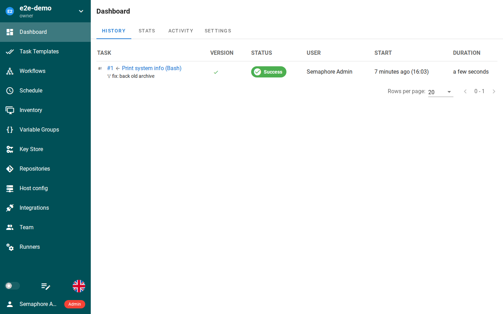

*Semaphore UI's task list — captured live from this template's own deployment during end-to-end testing.*

# Semaphore UI

Semaphore UI is a modern web UI and API for running Ansible, Terraform/OpenTofu, Shell, PowerShell, and Python automation — one place to run playbooks and scripts, keep credentials encrypted, schedule jobs, and see who ran what and when. One-click deploy creates a single Go service with a persistent volume and no companion database: projects, task templates, and run history live in SQLite on the volume, and the image already ships Ansible 13.5.0, OpenTofu, Terraform, and Terragrunt, so task templates run with no extra setup. After deploy, open the public URL and log in as `admin` with the generated password from the deploy form.

## Source Repository

[https://github.com/INAPP-Mobile/semaphore](https://github.com/INAPP-Mobile/semaphore)

## Deploy and Host

Deploying Semaphore UI on Railway gives you a private automation runner on your own volume. The wrapper maps Railway's injected `PORT` onto Semaphore's HTTP port on every boot (upstream ignores the generic `PORT`), points the config and SQLite database at the volume, seeds the admin account from the deploy form on first boot, and generates the access-key encryption key once per volume so stored credentials stay encrypted across redeploys. The deploy form has one generated field and nothing to type.

## Why Deploy

- Your automation, your server: playbooks and scripts run on your own volume — not in a SaaS runner that can disappear or bill per minute.
- No database to run: a single Go service with SQLite — no Postgres or MySQL companion to pay for.
- Toolchain included: Ansible 13.5.0, OpenTofu, Terraform, and Terragrunt ship in the image, so a task template that runs a playbook works out of the box.
- Credentials stay encrypted: the access-key encryption key is generated once per volume and reused on every boot; SSH keys and passwords are never stored in plain text.
- Schedules and audit trail: cron-style schedules, run history, and who-ran-what are built in.
- Small footprint: a single Go binary idling at tens of MB of RAM — the runner only spends CPU while a task is actually running.

## Common Use Cases

- Running Ansible playbooks without a terminal: point a task template at a repo and run it from the browser, with output streamed live.
- Scheduled infrastructure jobs: nightly Terraform applies, backup scripts, or server updates on a schedule.
- A shared runbook for a team: one place where approved playbooks run, with access control and an audit trail instead of shared SSH keys.
- Ad-hoc shell and Python tasks: run a script against a host from the web UI and keep the receipt.
- Separating duties: developers trigger deployments through task templates without direct server access.

## Configuration

| Variable | Default | Description |
| --- | --- | --- |
| `SEMAPHORE_ADMIN_PASSWORD` | `${{secret(16)}}` | Admin password for the seeded admin account (username `admin`). Generated per deploy; seeded exactly once per volume — changing it later does not change the password. |
| `SEMAPHORE_ADMIN` | `admin` | Admin username. Baked into the image; set the variable to change it before first boot. |
| `SEMAPHORE_ADMIN_EMAIL` | `admin@localhost` | Admin account email. Baked into the image. |
| `SEMAPHORE_ADMIN_NAME` | `Semaphore Admin` | Admin account display name. Baked into the image. |
| `SEMAPHORE_PORT` | (derived from `$PORT` at boot) | HTTP port Semaphore listens on. Set by the entrypoint from Railway's injected `PORT`; do not set it yourself. |
| `SEMAPHORE_DB_DIALECT` | `sqlite` | Database dialect: `sqlite`, `mysql`, or `postgres`. Baked to `sqlite` — single service, no companion database. |
| `SEMAPHORE_DB_HOST` | (derived from `SEMAPHORE_DB_PATH` at boot) | SQLite file path (`/data/db/database.sqlite`) for the sqlite dialect; host for mysql/postgres. Derived by the image's own setup wrapper. |
| `SEMAPHORE_DB_USER` / `SEMAPHORE_DB_PASS` / `SEMAPHORE_DB` | (unset) | Database credentials and name — only for the mysql/postgres dialects; unused with sqlite. |
| `SEMAPHORE_CONFIG_PATH` | `/data/config` | Directory holding `config.json` (cookie hash and encryption keys, generated on first boot). On the volume so sessions and stored credentials survive redeploys. Baked into the image. |
| `SEMAPHORE_DB_PATH` | `/data/db` | Directory holding the SQLite database. On the volume. Baked into the image. |
| `SEMAPHORE_TMP_PATH` | `/tmp/semaphore` | Task working directories (ephemeral per task). |
| `SEMAPHORE_WEB_ROOT` | (derived from `RAILWAY_PUBLIC_DOMAIN` at boot) | Public URL of the instance, used for links in notifications and task output. Set manually only for a custom domain. |
| `SEMAPHORE_ACCESS_KEY_ENCRYPTION` | (generated once per volume at boot) | Base64 of 32 random bytes; encrypts stored SSH keys and passwords. Generated by the entrypoint and stored at `/data/config/access-key-encryption` — never in the repo or the deploy form. Unset would mean plain-text credential storage. |
| `SEMAPHORE_OPTION_ENCRYPTION` | (unset) | Separate key for DB options (JWT signing); falls back to the access key when unset. |
| `SEMAPHORE_COOKIE_HASH` / `SEMAPHORE_COOKIE_ENCRYPTION` | (generated into `config.json` on first boot) | Session cookie signing keys. |
| `SEMAPHORE_EMAIL_ALERT` | (unset) | Set to `true` to enable email notifications for task results. |
| `SEMAPHORE_EMAIL_SENDER` / `SEMAPHORE_EMAIL_HOST` / `SEMAPHORE_EMAIL_PORT` / `SEMAPHORE_EMAIL_USERNAME` / `SEMAPHORE_EMAIL_PASSWORD` / `SEMAPHORE_EMAIL_SECURE` | (unset) | SMTP server used for email alerts. |
| `SEMAPHORE_LDAP_ACTIVATED` | `no` | Set to `yes` to enable LDAP login. |
| `SEMAPHORE_LDAP_HOST` / `SEMAPHORE_LDAP_PORT` / `SEMAPHORE_LDAP_DN_BIND` / `SEMAPHORE_LDAP_PASSWORD` / `SEMAPHORE_LDAP_DN_SEARCH` / `SEMAPHORE_LDAP_SEARCH_FILTER` | (unset) | LDAP server and bind settings. |
| `SEMAPHORE_GIT_CLIENT` | `cmd_git` | Git client for repositories: `cmd_git` or `go_git`. |
| `SEMAPHORE_HOME_DIR_MODE` | `template_home` | How HOME is set for task runs: `template_home` (default, per-template isolation), `project_home`, or `user_home`. |
| `SEMAPHORE_PLAYBOOK_PATH` | (unset) | Where playbooks are staged for task runs. |
| `SEMAPHORE_SSH_PATH` | (unset) | Custom SSH config path; default `~/.ssh/config`. |
| `SEMAPHORE_INTERFACE` | (unset) | Interface IP to bind; empty binds all interfaces. |

## First-run notes

- **Admin login is the public URL.** Username `admin`, password is the generated value from the deploy form (find it in the service's Variables tab). The account is seeded on first boot only.
- **Create a project first.** After login, create a project, then add a key (for target hosts), an inventory or repository, and a task template — a Shell template running `echo hello` is the quickest smoke test.
- **No signup, no email step.** The instance has exactly one seeded admin; add further users from the UI.
- **Tasks survive redeploys.** Projects, templates, and run history live in SQLite on the `/data` volume; redeploying the service keeps them. Stored credentials stay decryptable because the encryption key is generated once per volume.
- **Ansible, Terraform, and OpenTofu are in the image.** Task templates using them need no extra installation; use the project's Key Store for the SSH credentials tasks need.

### Deployment Dependencies

- A single Semaphore UI service (Go, SQLite, no companion service).
- One persistent volume mounted at `/data` (config at `/data/config/config.json`, SQLite at `/data/db/database.sqlite`, encryption key at `/data/config/access-key-encryption`).
- Plan tier: Hobby is enough — the service idles at tens of MB of RAM; task runs use CPU only while they execute.

## Upstream

Semaphore UI v2.20.23 by [semaphoreui](https://github.com/semaphoreui/semaphore), licensed MIT. Image pinned by manifest digest; see the `Dockerfile` header for the verified digest and the wrapper's design notes.
