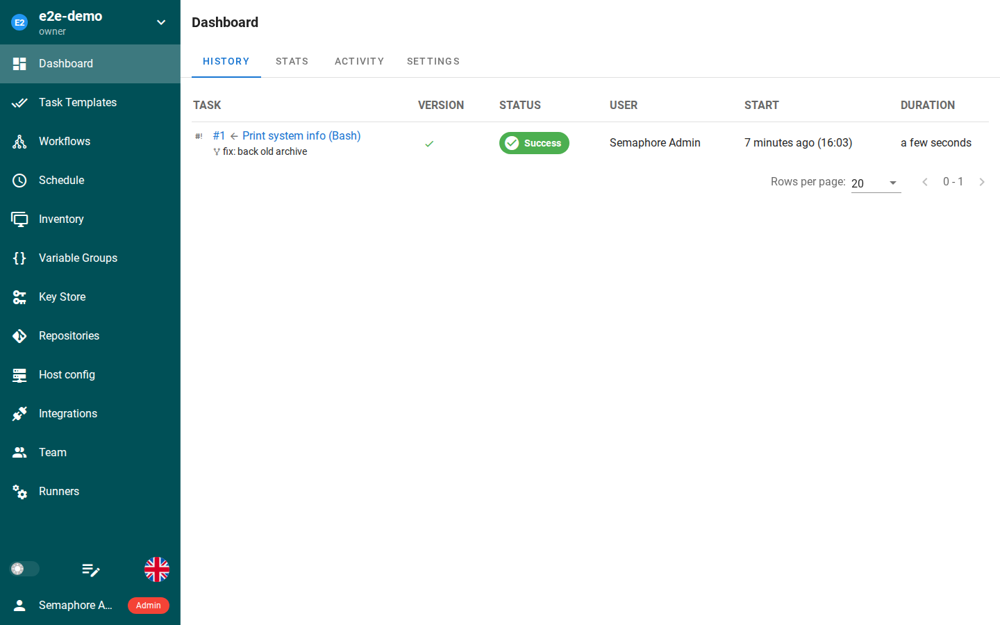

*Semaphore UI's task list — captured live from this template's own deployment during end-to-end testing.*

# Deploy and Host

Semaphore UI is a modern web UI and API for running Ansible, Terraform/OpenTofu, Shell, PowerShell, and Python automation — one place to run playbooks and scripts, keep credentials encrypted, schedule jobs, and see who ran what and when. One-click deploy creates a single Go service with a persistent volume and no companion database: projects, task templates, and run history live in SQLite on the volume, and the image already ships Ansible 13.5.0, OpenTofu, Terraform, and Terragrunt, so task templates run with no extra setup. After deploy, open the public URL and log in as `admin` with the generated password from the deploy form.

## About Hosting

Hosting Semaphore UI on Railway keeps your automation on your own volume instead of a SaaS runner. The deployment is a single always-on Go service: the wrapper maps Railway's injected `PORT` onto Semaphore's HTTP port on every boot (upstream ignores generic `PORT`), points the config and SQLite database at the volume, seeds the admin account from the deploy form on first boot, and generates the access-key encryption key once per volume so stored credentials stay encrypted across redeploys. The deploy form has one generated field and nothing to type. Ansible, Terraform, and OpenTofu ship in the image.

## Why Deploy

- Your automation, your server: playbooks and scripts run on your own volume — not in a SaaS runner that can disappear or bill per minute.
- No database to run: a single Go service with SQLite — no Postgres or MySQL companion to pay for.
- Toolchain included: Ansible 13.5.0, OpenTofu, Terraform, and Terragrunt ship in the image, so a task template that runs a playbook works out of the box.
- Credentials stay encrypted: the access-key encryption key is generated once per volume and reused on every boot; SSH keys and passwords are never stored in plain text.
- Schedules and audit trail: cron-style schedules, run history, and who-ran-what are built in.
- Small footprint: a single Go binary idling at tens of MB of RAM — the runner only spends CPU while a task is actually running.

## Common Use Cases

- Running Ansible playbooks without a terminal: point a task template at a repo and run it from the browser, with output streamed live.
- Scheduled infrastructure jobs: nightly Terraform applies, backup scripts, or server updates on a schedule.
- A shared runbook for a team: one place where approved playbooks run, with access control and an audit trail instead of shared SSH keys.
- Ad-hoc shell and Python tasks: run a script against a host from the web UI and keep the receipt.
- Separating duties: developers trigger deployments through task templates without direct server access.

## Dependencies for

- A single Semaphore UI service (Go, SQLite, no companion service).
- One persistent volume mounted at `/data` (config at `/data/config/config.json`, SQLite at `/data/db/database.sqlite`, encryption key at `/data/config/access-key-encryption`).
- Environment variables (condensed reference — full documentation in the repo README):

| Variable | Default | Description |
| --- | --- | --- |
| `SEMAPHORE_ADMIN_PASSWORD` | `${{secret(16)}}` | Admin password for the seeded admin account (username `admin`). Generated per deploy; seeded exactly once per volume. |
| `SEMAPHORE_ADMIN` | `admin` | Admin username. Baked into the image. |
| `SEMAPHORE_ADMIN_EMAIL` | `admin@localhost` | Admin account email. Baked into the image. |
| `SEMAPHORE_ADMIN_NAME` | `Semaphore Admin` | Admin account display name. Baked into the image. |
| `SEMAPHORE_PORT` | (derived from `$PORT` at boot) | HTTP port Semaphore listens on. Set by the entrypoint from Railway's injected `PORT`. |
| `SEMAPHORE_DB_DIALECT` | `sqlite` | Database dialect: `sqlite`, `mysql`, or `postgres`. Baked to `sqlite`. |
| `SEMAPHORE_DB_HOST` | (derived from `SEMAPHORE_DB_PATH` at boot) | SQLite file path for the sqlite dialect. |
| `SEMAPHORE_CONFIG_PATH` | `/data/config` | Directory holding `config.json`. On the volume. Baked into the image. |
| `SEMAPHORE_DB_PATH` | `/data/db` | Directory holding the SQLite database. On the volume. Baked into the image. |
| `SEMAPHORE_TMP_PATH` | `/tmp/semaphore` | Task working directories (ephemeral per task). |
| `SEMAPHORE_WEB_ROOT` | (derived from `RAILWAY_PUBLIC_DOMAIN` at boot) | Public URL of the instance. Set manually only for a custom domain. |
| `SEMAPHORE_ACCESS_KEY_ENCRYPTION` | (generated once per volume at boot) | Base64 of 32 random bytes; encrypts stored credentials. Generated by the entrypoint and stored on the volume. |
| `SEMAPHORE_EMAIL_ALERT` | (unset) | Set to `true` to enable email notifications for task results. |
| `SEMAPHORE_LDAP_ACTIVATED` | `no` | Set to `yes` to enable LDAP login. |

### Deployment Dependencies

- Plan tier: Hobby is enough — the service idles at tens of MB of RAM; task runs use CPU only while they execute.
- No companion database, no extra services.
